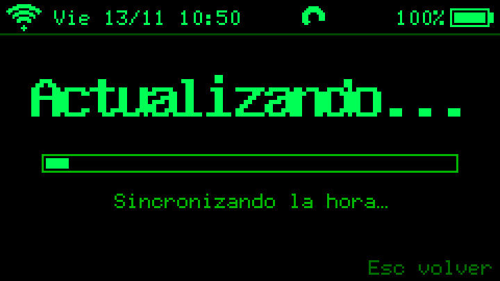
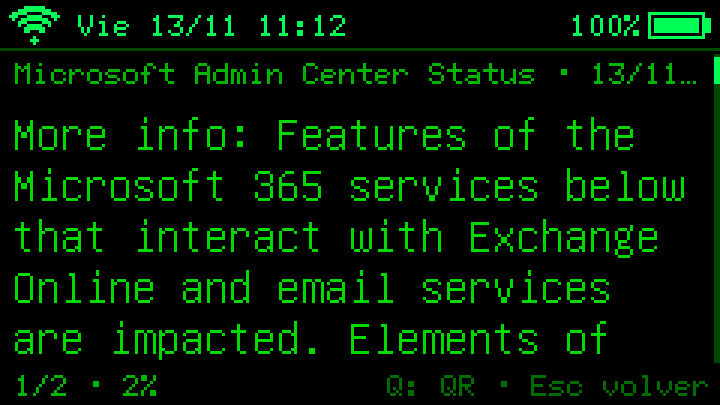

# TenoRSS (alfa)

Lector RSS para M5Stack Cardputer ADV. PlatformIO + M5Cardputer/M5Unified/M5GFX.

| Inicio | Actualizando | Lectura | QR |
|---|---|---|---|
|  |  |  |  |

Diagrama de bloques y flujo de pantallas: [docs/TenoRSS-diagrama.pdf](docs/TenoRSS-diagrama.pdf).

## Instalar

Binarios precompilados en `bin/`:

- `TenoRSS.bin`: solo la app. Copiarla a la microSD e instalarla desde M5Launcher.
- `TenoRSS-full.bin`: imagen completa, se graba en `0x0`
  (`esptool --chip esp32s3 write-flash 0x0 bin/TenoRSS-full.bin`, o M5Burner).
- Desde el código: `tools/flash.sh --full` (la primera vez) o `tools/flash.sh`.
  `pio run -t upload` falla con este equipo; el script usa un esptool más nuevo.
  Sin `--full` solo graba si el equipo ya tiene la tabla de particiones de
  TenoRSS; con M5Launcher instalado se niega, para no pisarlo.

## Uso

Al encender queda la pantalla de inicio hasta pulsar una tecla (mientras tanto
ya se conecta y actualiza). Teclas: `;` arriba, `.` abajo, `,` izquierda, `/` derecha, Enter aceptar,
`` ` `` (esc) o G0 volver. En lectura: espacio/Enter página siguiente,
`,` `/` ítem anterior/siguiente, `Q` QR del link (verde sobre negro). En WiFi Setup: `R` buscar,
Del borrar una red guardada; al tipear la clave, Fn+esc cancela.

Un minuto después de terminar un Update la WiFi se apaga para ahorrar batería y el
ícono pasa a amarillo. Se vuelve a conectar sola antes del próximo Update o al entrar
a WiFi Setup (al salir de ahí corre otra vez el minuto).

En la microSD se crea `RSSreader/` con:

- `wifi-config.txt`: redes conocidas (`[wifi N]`, `SSID="..."`, `PASS="..."`).
- `RSS.txt`: fuentes (`[Nombre]`, `URL="..."`) y `TZ="auto"` o `TZ="-3"`.
  `auto` consulta ip-api.com para saber el corrimiento horario.
- `cache.json`: últimos 20 ítems por fuente, con leído/no leído.

Los feeds HTTPS se bajan sin validar certificados.

## Desarrollo

- `test/host/run.sh`: pruebas en PC del parser, cache y configuración.
- `tools/cardctl.py`: teclas, capturas de pantalla y estado por USB serie.
- `tools/mkpdf.py`: regenera el PDF de `docs/` (requiere reportlab).

## Estructura

- `src/core/`: núcleo portable (parser de feeds, cache, configuración, texto).
- `src/`: firmware (`ui`, `net`, `storage`, `input`, `debugcon`, `main`).
- `test/host/`: pruebas de PC. `tools/`: scripts. `docs/`: diagrama y capturas.
- `bin/`: binarios precompilados.
